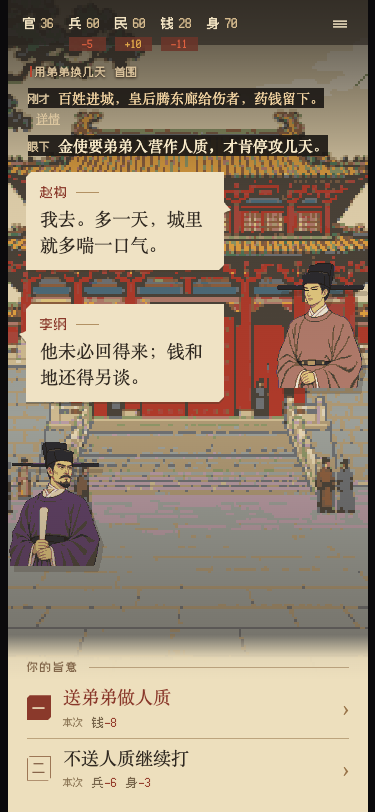

# Crown on the Brink · 开局就亡国

[Play online](https://gongty.github.io/crown-on-the-brink/) · [简体中文](README.md)

You have just become emperor. The invading army is already on its way.

A pixel-art narrative game set at the end of the Northern Song dynasty. You wake up as Emperor Qinzong, knowing that the Jingkang disaster is approaching. Knowledge alone cannot decide who should command your army, who should pay for it, or which city receives the last reinforcements. The people you save, the ministers you offend, and the soldiers you borrow will shape what comes next.



## Play

Face one situation at a time, usually with two commands to choose from. Characters make their requests through short dialogue. Give your order and move straight to the next event; changes in the scene, values, and character reactions carry its consequences. There is no task hub and no revisiting earlier scenes within a run.

Five visible values track court cooperation, available military strength, public welfare, treasury, and health. Decisions change these values and establish facts that later events remember. Unavailable choices remain visible with an explanation. Executable risks are yours to judge.

Good preparation can save the capital, turn the war around, or reclaim a city you lost. You can also abandon the capital and take the court south by choice. After a truce, deciding who bears responsibility for the war and whose family receives compensation still falls to you. A mistake may cost you the throne or end your life.

- 118 story nodes and 214 branches; a national campaign typically involves a few dozen substantial decisions, while early death can end a run sooner.
- 10 national endings with good and bad outcomes, 4 personal departures, 11 mid-story death endings, and 1 hidden ending.
- All ten national endings are reachable from a fresh profile. Hidden content involves discoveries across runs.
- Starting variations in weather and supplies affect resources; death is not decided by a new random roll after you choose.
- Local autosaves and ending collections. Clearing browser site data removes these records.
- Mouse and touch controls. The game text is in Simplified Chinese; project documentation is bilingual.

## Run locally

Install Node.js, npm, and Python 3. Font generation uses fontTools and Brotli. This release was independently installed, tested, and built with Node.js 25.6.1 and Python 3.13.5. Create a separate Python environment:

```sh
npm ci
python3 -m venv .venv
. .venv/bin/activate
python -m pip install -r requirements-build.txt
npm run dev
```

Open the address printed by the development server, normally `http://localhost:8878`. Activate `.venv` before subsequent starts so the font tools remain on PATH.

```sh
npm test
npm run build
```

`dist/` contains the deployable static game. Serve it over HTTP rather than opening its HTML file directly. The running game needs no game backend or model API.

## Edit the story

The current story source is `docs/剧本/节点网设计.json`; visual bindings are in `docs/美术/v4/终局与人物绑定.json`. The story forms a forward-only directed acyclic graph: choices write state and later events evaluate it. Compilation checks resources and versions. Tests replay design witnesses against the actual engine, comparing each step.

When changing rules or routes, regenerate valid route witnesses and update the binding version rather than merely renaming an ending. A small set of legacy inputs remains for regression tests; the live game uses v4 only.

## History and production

Historical figures and campaigns provide the setting. The story diverges into alternate history when the protagonist takes the throne. Dialogue, changed campaigns, personal storylines, and fantastical elements are fiction. The game depicts war, death, and family separation without graphic gore.

Visual assets include AI generation, references reused within the project, pixel processing, and programmatically drawn elements. Music and sound effects are synthesized in the browser. See [ART_SOURCES.md](ART_SOURCES.md).

## Release scope

This is a complete beginning-to-ending game, with Simplified Chinese in-game text. Five AI playtesters completed 11 runs and 244 decisions. Their feedback led to additional personal closure after losing political power, clearer mortal-risk warnings, and visible consequences for the final order. See [playtest and validation notes](PLAYTEST.md) for the original scores and remaining limitations; the final changes have not been assigned a new aggregate playtest score.

## License

Code, story text, and project documentation use the [MIT License](LICENSE). Visual assets may be used to run, modify, and distribute this game under the [asset terms](ASSET_LICENSE.md). Fonts and dependencies retain their own licenses. See [LICENSE_SCOPE.md](LICENSE_SCOPE.md) and [THIRD_PARTY_NOTICES.md](THIRD_PARTY_NOTICES.md).
