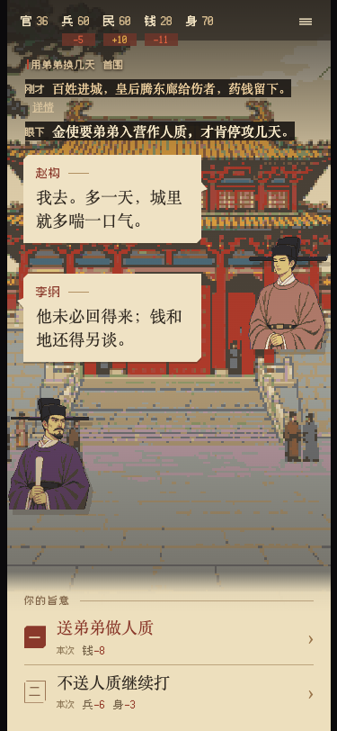

# 开局就亡国 · Crown on the Brink

[在线游玩](https://gongty.github.io/crown-on-the-brink/) · [English](README.en.md)

你刚当上皇帝，金军就要到了。

一款以北宋末年为背景的像素风互动剧情游戏。你穿越成宋钦宗，知道靖康之变将要发生，却仍得决定：兵权交给谁，军饷向谁要，援军救太原还是留在东京。你救下的人、得罪的臣子、借来的兵，会在后面的决定里回来找你。



## 怎么玩

每次只面对一件事，通常在两条命令之间选择。人物用短对白说清处境与诉求；点选即进入下一件事，后果随画面、数值与回响呈现。没有任务大厅，也不能在同一局返回旧节点补做事情。

五项状态是朝廷执行、可调战力、民心民生、国库和身体。选择改变状态，状态与先前发生的事共同决定后续机会。无法执行的选项仍然可见，并说明缺什么；能执行的险招，需要你自己判断。

准备充分，可以保住东京、扭转战局，甚至失城后再夺回来。你也能主动舍都南撤，把战争带到另一条路上。停战以后，谁承担战责、谁保住抚恤，仍要由你拍板。判断失误可能失去皇权，或当场结束一生。

- 118个剧情节点，214条分支；一局国家主线通常有20多次实质决定，提前死亡会更短。
- 10种有好有坏的国家结局、4种个人离场、11处中途死亡断点，以及1个隐藏结局。
- 十种国家结局均可在新档抵达；隐藏内容需要跨局发现。
- 天气、补给等开局差异影响资源；不会在选完后临时抽签判你死亡。
- 本地自动存档与结局收藏。清除浏览器站点数据会清除记录。
- 点击或触摸游玩；游戏正文为简体中文，项目说明提供中英文。

## 本地运行

需要Node.js、npm和Python 3。字体构建使用fontTools和Brotli。本版已在Node.js 25.6.1、Python 3.13.5下完成独立安装、测试和构建。以下步骤会建立独立Python环境：

```sh
npm ci
python3 -m venv .venv
. .venv/bin/activate
python -m pip install -r requirements-build.txt
npm run dev
```

打开终端输出的地址，默认是 `http://localhost:8878`。再次启动时先激活 `.venv`，让字体构建工具位于PATH中。

```sh
npm test
npm run build
```

`dist/`是可部署的静态游戏；请通过HTTP服务器打开，不要直接双击HTML文件。运行时不需要游戏后端或模型API。

## 修改故事

正式剧情源是 `docs/剧本/节点网设计.json`，美术绑定是 `docs/美术/v4/终局与人物绑定.json`。故事是只向前的有向无环图：选择写入状态，后续节点读取条件。编译会核对资源与版本，测试包含设计见证与实际引擎的逐步一致性检查。

改变规则或路径时，应重新生成合法入口见证并更新绑定版本；不要只修改某个结局标签。源码保留少量旧版本测试输入，正式运行入口只使用v4。

## 历史与制作

历史人物和战事提供背景，从主角接位起进入架空分岔。具体对白、改变后的战局、个人支线与幻想内容均为创作，不应作为史实引用。故事含战争、死亡与家庭离别，采用非血腥表现。

视觉素材包含AI生成、项目内参考复用、像素化处理和程序绘制；音效与音乐使用浏览器合成。来源见 [ART_SOURCES.md](ART_SOURCES.md)。

## 版本与边界

这是可从开场玩到结局的完整版本，游戏正文为中文。五位AI评审完成11局、244次决定后，已针对反馈补齐失权后的私人收束、致命风险说明和末次命令回应。原始评分与尚待打磨之处见[实玩与验证说明](PLAYTEST.md)，不把修订后版本冒称重新评分通过。

## 许可

代码、剧本和项目文档使用[MIT许可](LICENSE)。视觉素材允许用于运行、修改和分发本游戏，具体范围见[素材使用说明](ASSET_LICENSE.md)。字体及依赖保留各自许可，见[许可范围](LICENSE_SCOPE.md)与[第三方声明](THIRD_PARTY_NOTICES.md)。
